# Textly

<p align="center">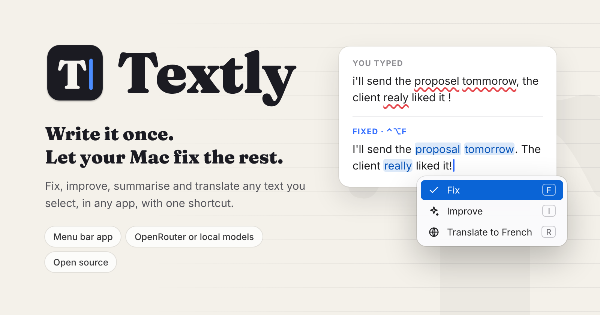</p>

<p align="center"><a href="https://github.com/themaximehardy/Textly/releases/latest"><b>Download for macOS</b></a> · macOS 14+ · Free and open source</p>

**Fix, improve, summarise and translate any text on your Mac.** Select text in any app, press a shortcut, pick an action. The result replaces your selection, shows up first, or lists each change for you to accept.

Textly lives in the menu bar and is open source. It uses [OpenRouter](https://openrouter.ai) with your own API key (you choose the model and pay only for what you use, usually a fraction of a cent per use), or a model running on your Mac with [Ollama](https://ollama.com) or [LM Studio](https://lmstudio.ai).

<p align="center">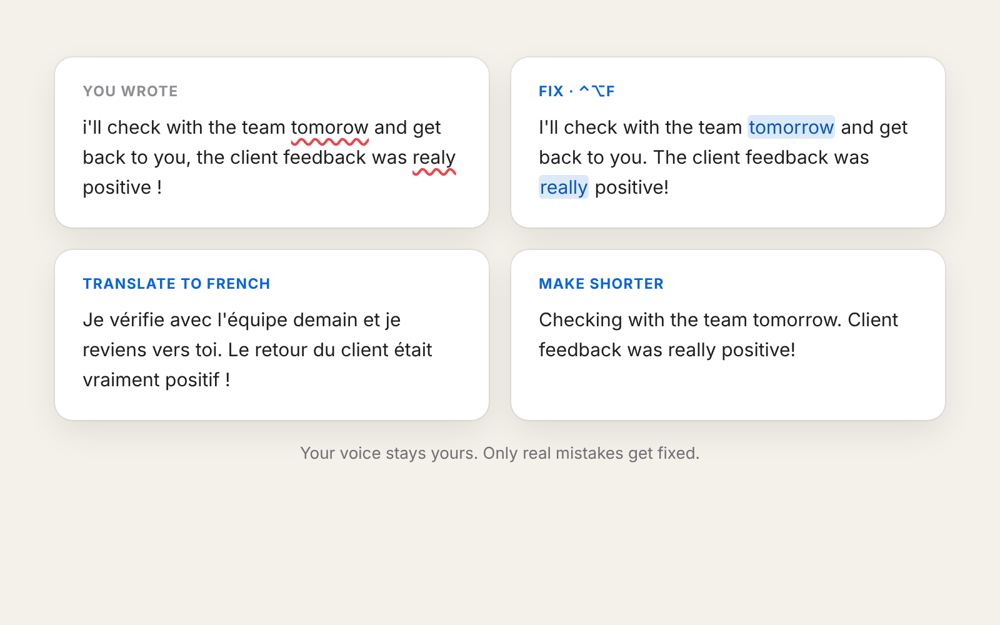</p>

## Features

### Works everywhere
- Any app where you can select text: Mail, Slack, Notion, Chrome, Safari, Google Docs, Word, VS Code, Notes…
- Reads the selection directly when the app allows it, otherwise copies it for you and puts your clipboard back. Apps that hide their text (Electron apps, Chromium browsers, web editors) are handled automatically: see [COMPATIBILITY.md](COMPATIBILITY.md).
- Pastes the result in place and keeps the spaces and line breaks around your selection.
- Never reads password fields.

### Actions
- **Fix**: only real mistakes (spelling, grammar, accents, punctuation), with the smallest possible changes.
- **Improve**: clearer and smoother, still sounding like you.
- **Summarise**: key points, decisions, figures and action items.
- **Translate** to any language: your pinned languages get their own letter, any other is one search away ("Spanish (Mexico)", "formal German"…).
- **Make shorter**, and **your own actions**: a name, an icon and an instruction ("Reply politely", "Turn into bullet points"…).
- **Action packs**: Settings › Actions › **Export…** saves your actions to a file to send to anyone; **Import…** adds theirs. Starter packs in [docs/packs](docs/packs): Email and messages, Work, Social.

<p align="center">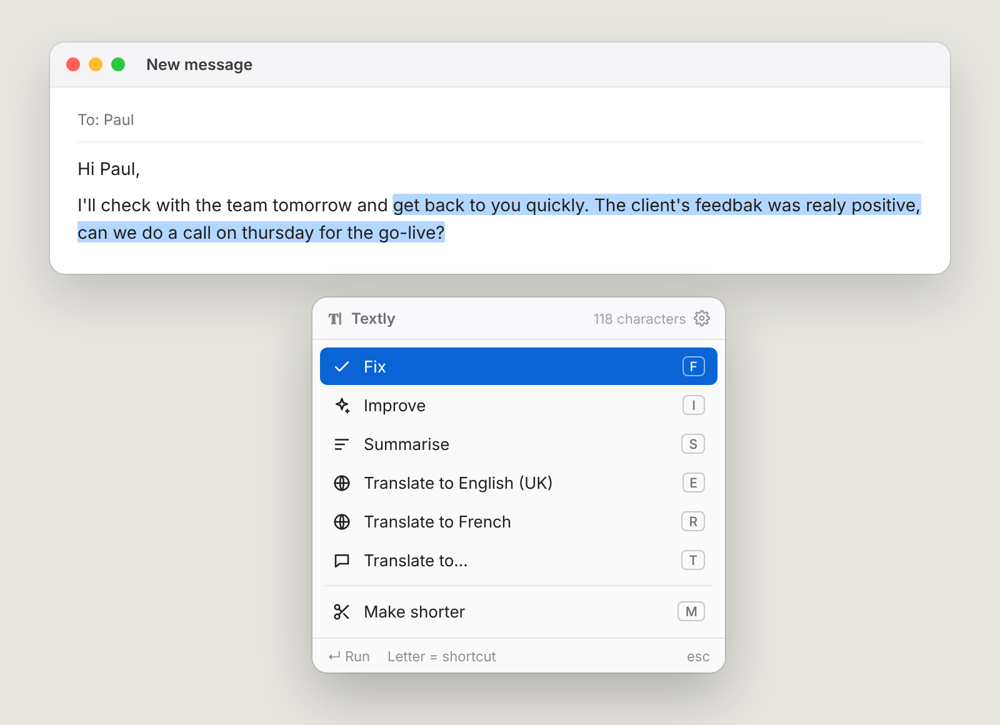</p>

<p align="center">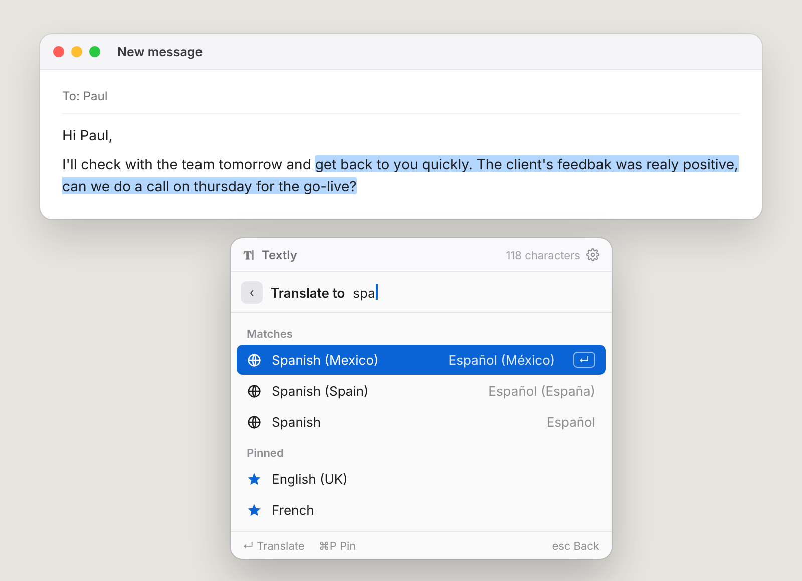</p>

### You decide how results arrive
Each action has its own result mode (Settings › Actions › Result):
- **Replace straight away**: the selection is swapped as soon as the answer arrives.
- **Show the result first**: the whole result with changes highlighted, ↵ to replace.
- **Review each change**: every suggestion on its own row (~~old~~ → new). Keep or drop each one with a click or the space bar, then apply only what you kept.

Hold **⇧** when you pick an action in the palette to review the changes just this once, whatever its setting.

<p align="center">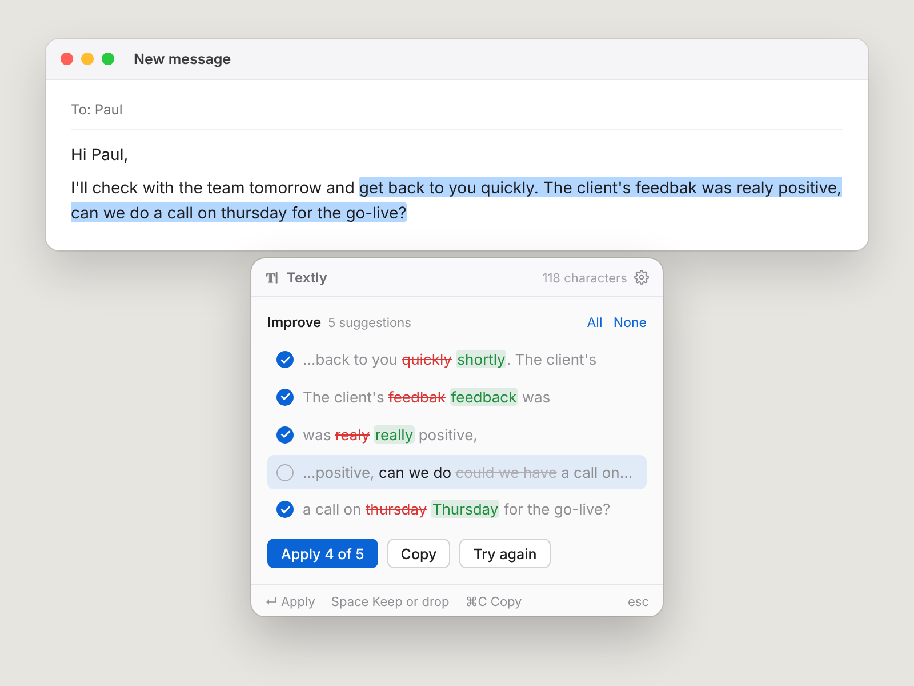</p>

<p align="center">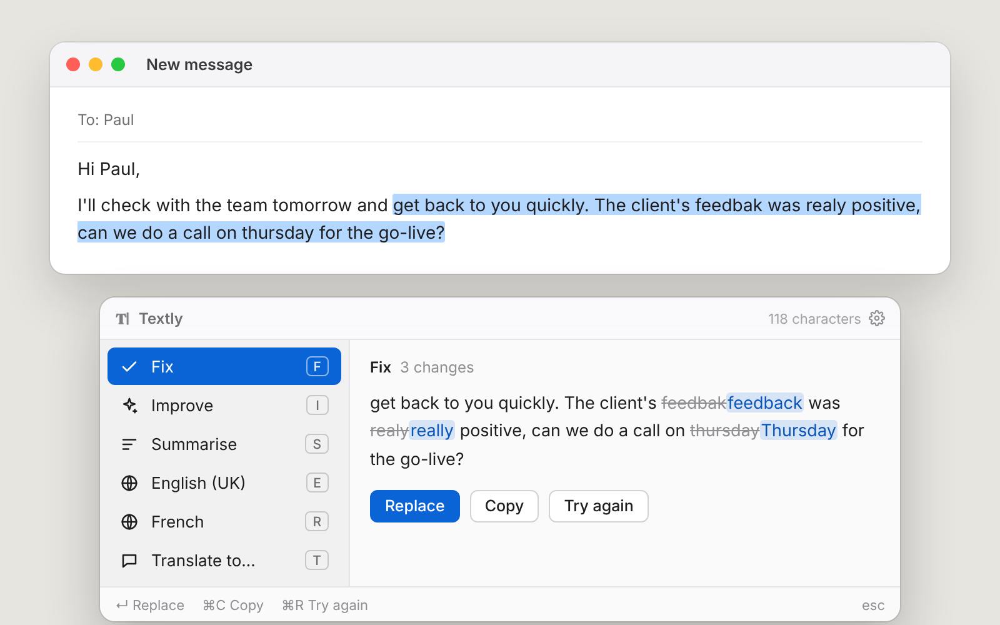</p>

### Live results
The answer appears word by word while it's being written, so you can read along and press esc if it's going the wrong way.

<p align="center">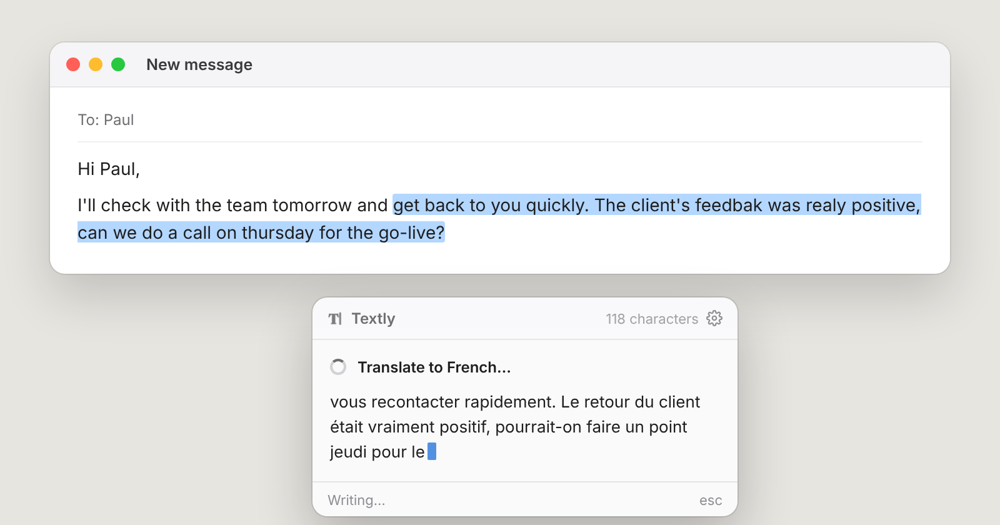</p>

### Undo anything
- **⌃⌥Z** (or menu bar › Revert Last Change) puts your original text back. Press it again to swap back to the result.
- **Recent Results** in the menu bar: your last 20 results, to paste or copy again (the result or your original). Kept in memory, or after quitting if you turn it on.
- ⌘Z in the app you were writing in works too.

<p align="center">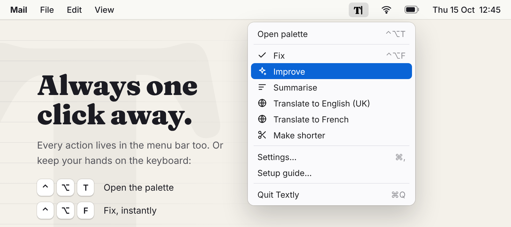</p>

### Sounds like you
- **Your languages**: during setup, pick the languages you write in, British or American English, whether you mix languages (Franglais welcome), and whether to avoid long dashes. Textly writes its rules from that.
- **Shared rules**: your tone, spelling and punctuation habits, added to every action. Edit them freely.
- **Glossary**: brand, product and people's names always spelled your way and never translated. `wrong → right` fixes a spelling every time.
- **Every prompt is editable**, with a **Try it** box to test changes on sample text (time, tokens and cost shown).

<p align="center">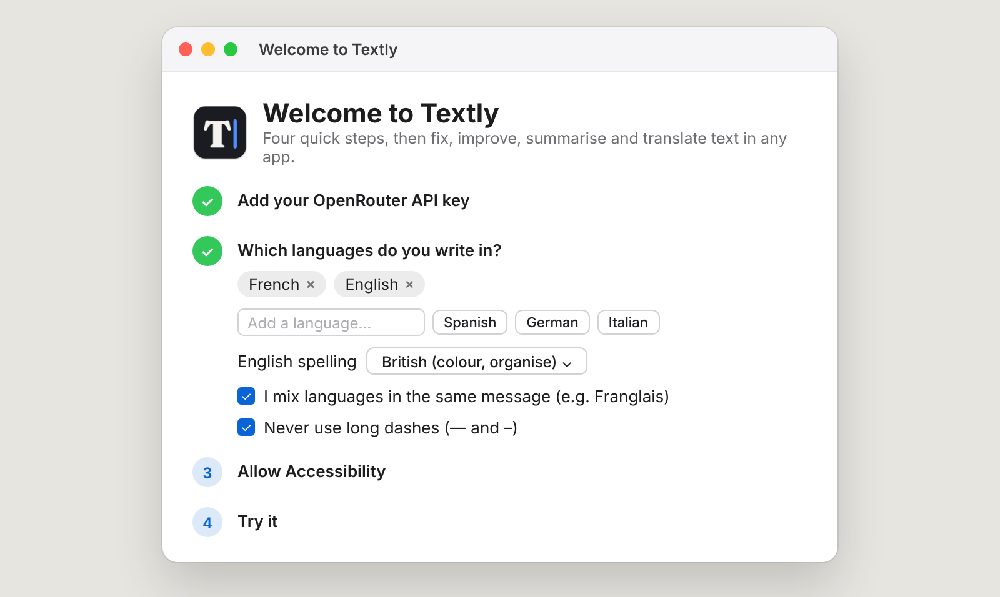</p>

<p align="center">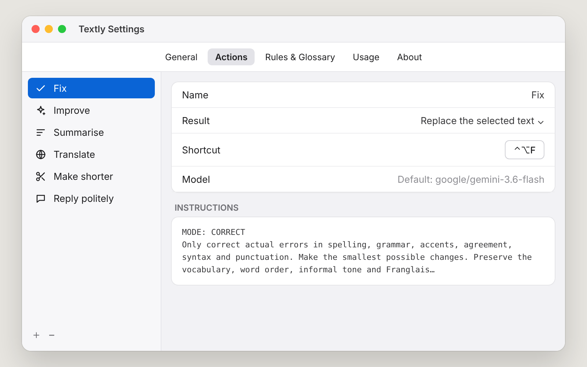</p>

### Your choice of AI
- **OpenRouter**: hundreds of models (Gemini, Claude, GPT, Mistral, Llama…) with one key. Pick a default model, or a different one per action. Prices are shown as you browse.
- **Local models**: Ollama, LM Studio or any OpenAI-compatible server. Free, private and offline.
- **Fast mode** skips long reasoning so answers come back quicker.
- **Privacy mode** only uses providers that don't store or train on your text.

<p align="center">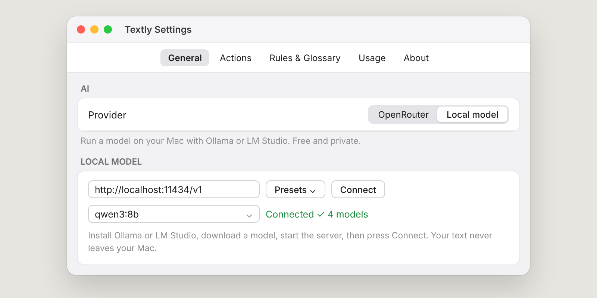</p>

### Know what it costs
Settings › Usage shows what you've spent today, this week and this month (exact costs from OpenRouter), and estimates your monthly cost from how often you use it. With a fast, inexpensive model, everyday use usually costs cents a month.

<p align="center">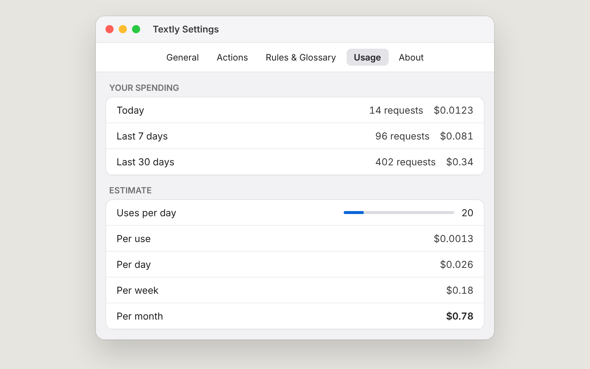</p>

### At home on your Mac
- Menu bar app, no Dock icon. Opens at login if you want.
- A palette right next to your selection, driven by the keyboard: one letter per action.
- Two palette styles: a compact **command list**, or **preview** with the result beside the actions.
- A global shortcut for the palette, plus one per action (⌃⌥F fixes straight away).
- **Right-click › Services › Textly** in apps built with Apple's text controls (Mail, Notes, Pages, Safari…).
- Choose the logo and the menu bar icon.
- Checks for updates once a day and installs them itself (Install and Relaunch).
- Shows its version in the menu bar menu, the palette and Settings.

### Private by design
- Text is sent only when you trigger an action, only to the AI you chose.
- API key in the macOS Keychain. No account, no analytics, no tracking.
- History stays in memory unless you ask to keep it. See [SECURITY.md](SECURITY.md).

## Install

**Requirements:** macOS 14 (Sonoma) or later, and either an [OpenRouter API key](https://openrouter.ai/keys) or a local model server ([Ollama](https://ollama.com), [LM Studio](https://lmstudio.ai)).

### Download

1. Download the latest **Textly-x.y.z.dmg** from [Releases](https://github.com/themaximehardy/textly/releases/latest).
2. Open it and drag **Textly** to **Applications**.
3. Open Textly. Because it isn't notarised by Apple yet, macOS says it can't verify the app. Click **Done**, then go to **System Settings › Privacy & Security**, scroll down and click **Open Anyway**. You only need to do this once.
4. Follow the setup window: paste your API key (or choose a local model), pick your languages, then allow Accessibility.

**Updates**: Textly checks for new versions once a day (or menu bar › Check for Updates…) and installs them itself with **Install and Relaunch**.

> Until Textly is signed by Apple, macOS asks for Accessibility again after each update. If Textly stops responding to the shortcut, open System Settings › Privacy & Security › Accessibility, remove Textly with **−** and add it again with **+**. Textly restarts by itself once it's allowed.

### Build from source

1. Clone this repo and open `Textly.xcodeproj` in Xcode 16 or later.
2. Select the **Textly** target › **Signing & Capabilities** and choose your own **Team** (a free Apple ID "Personal Team" works). This keeps the Accessibility permission from being reset every time you rebuild.
3. Press **Run** (⌘R). Textly appears in the menu bar and opens the setup window. Run the tests with ⌘U.
4. To make a DMG yourself: `scripts/make-dmg.sh` creates `dist/Textly-x.y.z.dmg`.

## Keyboard

| | |
|---|---|
| **⌃⌥T** | Open the palette next to your selection |
| **F / I / S / E / R / T…** | Run an action from the palette (each row shows its letter) |
| **⇧ + letter** (or ⇧↵) | Run it and review each change before applying |
| **↑ ↓ ↵** | Move and run |
| **T** | Translate to any language: type it, press ↵ (⌘P pins it) |
| **⌃⌥F** | Fix the selection directly, no palette |
| **⌃⌥Z** | Revert: put your original text back (again to redo) |
| **Space** | When reviewing: keep or drop the highlighted change |
| **⌘C / ⌘R** | Copy the result / try again |
| **esc** | Close, or stop while the answer is being written |

All shortcuts can be changed in Settings.

## How it works

1. The selection is read with the macOS Accessibility API. If an app doesn't expose it, Textly simulates ⌘C and restores your clipboard afterwards. (With Services, macOS hands the text over directly.)
2. The prompt is built from the shared rules, the action's instruction, your glossary and fixed output rules. The selected text is sent inside `<text>` tags, so it is never treated as instructions.
3. The request goes to OpenRouter's chat completions API, or to your local server's (same format), and the answer is streamed back.
4. The result is pasted with ⌘V into the app you were in, then your clipboard is restored. To revert, Textly selects the pasted text again and pastes your original over it (or presses ⌘Z when the app doesn't say where the text is).

Settings are stored in `~/Library/Application Support/Textly/settings.json`. The API key is stored in your Keychain.

## Roadmap

- Signed and notarised download (Apple Developer ID), then fully automatic updates and a Homebrew cask
- More action packs from the community

## Contributing

Issues, app compatibility reports, action packs and pull requests are welcome. The code is plain Swift and SwiftUI with no dependencies. Start with [CONTRIBUTING.md](CONTRIBUTING.md).

## Releasing

1. In Xcode, Textly target › General: bump **Version** (e.g. 0.4.0) and **Build**.
2. Add what changed to `CHANGELOG.md` under the new version.
3. Commit, tag and push:
   ```
   git commit -am "Release 0.4.0"
   git tag v0.4.0
   git push origin main --tags
   ```
4. GitHub Actions builds the DMG on a Mac and publishes the release with the changelog as notes (about 5 minutes).

## Credits

The logo is set in [Fraunces](https://fonts.google.com/specimen/Fraunces) by Undercase Type, used under the SIL Open Font License.

## Changelog

See [CHANGELOG.md](CHANGELOG.md).

## Licence

MIT. See [LICENSE](LICENSE).
